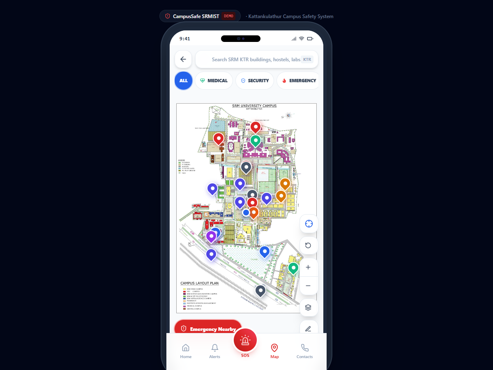
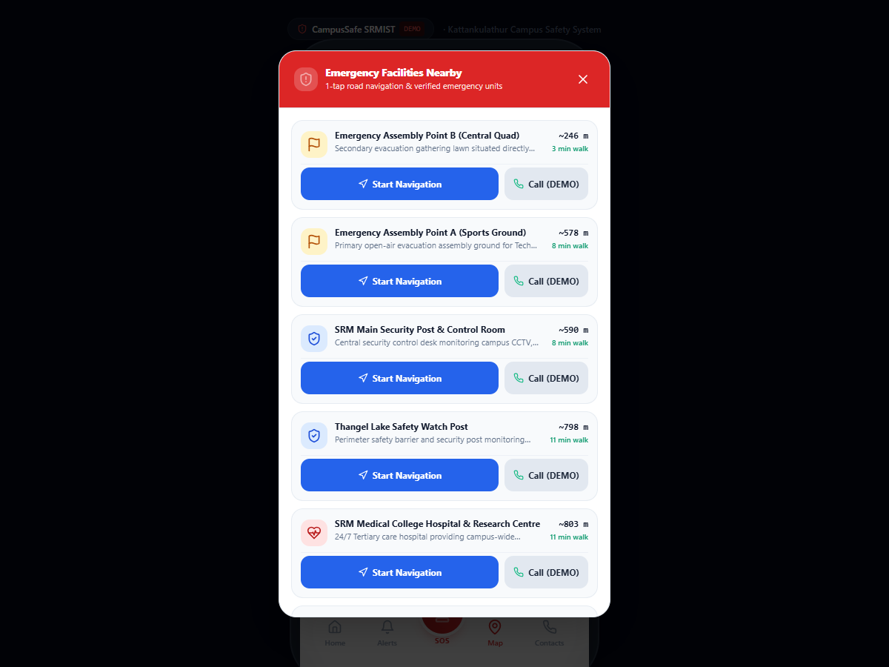

# CampusSafe SRMIST — Demo V1

A mobile-first campus safety and **Google Maps-style navigation web app** designed specifically for **SRM Institute of Science and Technology (SRMIST)**, Kattankulathur.

This repository is frozen at **Demo V1** (`tag: Demo-V1`).

---

## 📸 Screenshots

### 1. Main Campus Map & Navigation Overview
Interactive Leaflet map rendered on the real SRMIST layout plan with live "You Are Here" marker, search bar, and 7 category filters.



### 2. Emergency Nearby Drawer
One-tap access showing reachable emergency facilities, hospitals, security posts, fire stations, and assembly points sorted by actual walking road distance.



---

## ⚡ Quick Setup Steps

Run these commands in your terminal:

```bash
# 1. Install dependencies
npm install

# 2. Start the local development server
npm run dev
```

Open your browser and navigate to:
- 🗺️ **Campus Map & Navigation**: [http://localhost:3000/map](http://localhost:3000/map)
- 🏠 **Home Dashboard**: [http://localhost:3000/home](http://localhost:3000/home)
- 🚨 **SOS Emergency Screen**: [http://localhost:3000/sos](http://localhost:3000/sos)
- ✏️ **Marker Editor Mode**: [http://localhost:3000/map?edit=1](http://localhost:3000/map?edit=1)

---

## 🌟 Key Features in Demo V1

1. **Google Maps-Style Road Routing (`src/utils/campusNavigation.js`)**:
   - Uses **Dijkstra’s algorithm** over a connected graph of real SRMIST campus roads and walkways.
   - Routes **strictly follow actual campus roads and walkways** and never pass through buildings.
   - Shows blue walking polyline, turn-by-turn guidance banner, distance in meters, and walking time.
   - Features a **"Demo Walk"** button that animates the user marker node-by-node along the path!

2. **Search Anywhere with Autocomplete**:
   - Searches any building, hostel, lab, department, or facility.
   - Shows live walking distance right in the suggestions (e.g. `Tech Park · ~180 m away`).
   - Selecting a place automatically zooms and opens its information card.

3. **Emergency Nearby (1-Tap Access)**:
   - High-visibility floating red button opens reachable medical, security, fire, and assembly posts.
   - 1-tap "Start Navigation" generates an instant road route to the facility.
   - 1-tap "Call" connects through the in-app simulated dialer.

4. **Live Location & Recenter**:
   - Blue "You Are Here" marker with animated radar ping.
   - Recenter crosshair button to smoothly fly the map back to your position.
   - Draggable marker for testing navigation from anywhere on campus.

5. **7 Quick Category Filters**:
   - `ALL`, `MEDICAL`, `SECURITY`, `EMERGENCY`, `HOSTELS`, `ACADEMIC`, and `FOOD`.

6. **Interactive Marker Editor**:
   - Hidden editor mode (`?edit=1` or toggle in Settings) allows clicking the map to place pins, dragging markers, and clicking **"Export JSON"** to download updated data.

7. **Safety Red SOS Flow & Simulated Calling**:
   - 5-second countdown with cancel option.
   - Dynamic identification of the nearest safety post with timestamped simulation banner.
   - Simulated dialer modal with call timer, mute, speaker, and end call controls.

---

## 🏛️ Building Data Sources (In Plain English)

All campus data in this project is based strictly on real SRMIST Kattankulathur assets:

1. **Base Map (`assets/srmist-campus-map.png`)**:
   - The uncompressed, official SRM University Campus Layout Plan (683 × 1024 px).
   - Rendered using Leaflet with Cartesian `L.CRS.Simple` coordinate mapping.

2. **Campus Locations (`src/data/locations.json`)**:
   - Every verified pin corresponds to a place visibly labelled on the layout plan:
     - **BELL Block**: Basic Engineering Laboratory building in the central engineering cluster.
     - **SRM Medical College Hospital & Trauma Centre**: The large circular medical hub at the top of campus.
     - **Main Security Post & CCTV Control**: Stationed at Main Arch Gate entrance along GST Road.
     - **Central Library & Tech Park**: The core academic engineering towers.
     - **Hostel Clusters**: Kaari, Paari, Senbagam, and Meenakshi residential blocks on the east avenue.
     - **Potheri Railway Station & Arch Gate**: The primary southern transit entrances.
     - **Emergency Assembly Points**: Positioned on the open Main Sports Ground (Point A), Central Quad (Point B), and Hospital Quad (Point C).

3. **Road Graph (`src/utils/campusNavigation.js`)**:
   - Derived directly from the light-colored pathways marked **"R - ROADS"** on the layout plan.
   - Covers Main Entrance Avenue, Central Quad, Hostel Boulevard, Sports Ground Corridor, and Medical Loop.

---

## 🚀 Next Steps (In Plain English)

For extending this demo project into a live production deployment:

1. **Real Backend & Database**:
   - Replace the local JSON files and `localStorage` with a Node.js / Express or FastAPI backend backed by PostgreSQL or MongoDB.
   - Provide an admin API to add, edit, or archive campus markers and broadcast alerts.

2. **Real-Time GPS Georeferencing**:
   - Apply affine coordinate transformation (WGS84 GPS latitude/longitude to pixel `[y, x]`) so a student walking with their phone on campus gets automatically positioned without manual dragging.

3. **Live WebSockets for Campus Safety**:
   - Implement Socket.io so security control rooms can see active SOS alerts and student live location broadcasts on their dispatch dashboard in real time.

4. **SMS / Twilio Emergency Dispatch**:
   - Wire the SOS button to a cloud SMS gateway (e.g. Twilio) to dispatch automated emergency SMS messages with live Google Maps links to designated hostel wardens or security officers.

5. **SRM Single Sign-On (SSO)**:
   - Connect the login screen to official SRMIST student portal credentials via OAuth2 / SAML.
